<div align="center">

<a href="https://revoluzen.io"></a>

# Revoluzen Flow

### Local-first data pipeline engine

**Visual ETL on a vectorised DuckDB core — on your laptop, your VM, your rules.**

[](https://github.com/revoluzen-io/revoluzen-flow/actions/workflows/ci.yml)
[](https://github.com/revoluzen-io/revoluzen-flow/actions/workflows/security-scan.yml)
[](LICENSE)
[](pyproject.toml)
[](CHANGELOG.md)

[Quick start](#quick-start) · [What it looks like](#what-it-looks-like) · [Why](#why-revoluzen-flow) · [Connectors](#connectors) · [Docs](docs/)

</div>

---

```bash
git clone https://github.com/revoluzen-io/revoluzen-flow.git
cd revoluzen-flow
cd frontend && npm ci && npm run build && cd ..
python -m venv .venv && source .venv/bin/activate
pip install -e .
python -m revoluzen_flow open
```

The backend boots on loopback, your browser opens, and you're in. Needs Python
3.11+ and Node 20+. On Windows, or for Docker, see [Quick start](#quick-start).

<div align="center">
  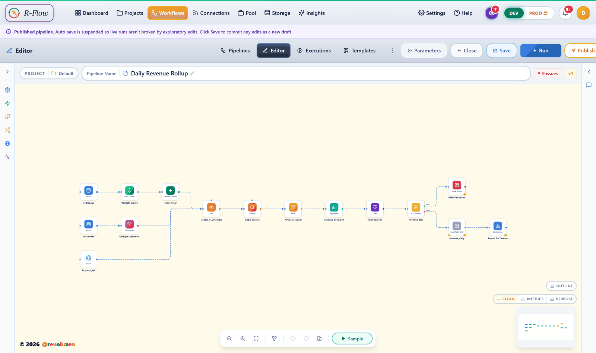
  <em>Build pipelines on a canvas · 45 node types · 68 connectors · run, schedule and alert from the same place</em>
</div>

> [!NOTE]
> **1.0.1 stable.** The full test suite runs on **Python 3.11 and 3.13** in CI
> (3.12 is smoke-tested and sits between the two) · Docker 25+ · DuckDB 1.1.3 ·
> Postgres 16. Source and Docker installs work today; the PyPI package, Linux
> packages and prebuilt desktop installers are not published yet. See
> [CHANGELOG.md](CHANGELOG.md) for the tested-with matrix and known gaps.

## Contents

| | |
|---|---|
| [🚀 Quick start](#quick-start) | Pick an install path |
| [🖼 What it looks like](#what-it-looks-like) | The product, in screens |
| [▶️ First run](#first-run) | Install to real output in a minute |
| [⚙️ Running it](#running-it) | Ports, background service, cloud |
| [💡 Why Revoluzen Flow](#why-revoluzen-flow) | What you get, and why it matters |
| [🔌 Connectors](#connectors) | An open framework, not a vendor queue |
| [🛡 Steward](#steward-reliability-layer) | Read-only pipeline health |
| [📦 Editions](#editions) | OSS vs Enterprise |
| [🔧 Install troubleshooting](#install-troubleshooting) | Every failure we know about |

## Quick start

Revoluzen Flow is a **self-hosted server plus web app** — a backend that serves
a browser UI, not a desktop program.

| You are | Path | Time |
|---|---|---|
| On any OS and want it to just work | **[Docker Compose](#docker-compose)** — one identical command everywhere | 2–5 min |
| Comfortable with Python 3.11+ and Node 20+, or a contributor | **[From source](#from-source)** | 10 min |

Not available yet, because no release has been published: the
[one-line install](#one-line-install), [PyPI](#pypi) and
[Linux packages](#linux-package). They are described below for when it is.

> [!TIP]
> Hitting an error? Everything we know about install failures is collected in
> [Install troubleshooting](#install-troubleshooting) rather than scattered
> through these steps.

### One-line install

> [!IMPORTANT]
> **Not available yet.** This script downloads from the latest GitHub Release,
> and none has been published. Use [Docker Compose](#docker-compose) or
> [From source](#from-source) for now.

Linux x86_64. Installs per-user, no root. The AppImage it fetches carries its
own Python runtime, so nothing needs to be on the machine first.

```bash
curl -fsSL https://raw.githubusercontent.com/revoluzen-io/revoluzen-flow/main/installer/install.sh | sh
```

Then `revoluzen serve` and open <http://localhost:8001>.

It resolves the latest release, verifies the download against the release's
`SHA256SUMS` and **aborts if that check fails or the file is unlisted**, installs
to `~/.local/share/revoluzen-flow`, and links `~/.local/bin/revoluzen`. It does
not edit your shell profile — if `~/.local/bin` is not on `PATH` it prints the
line to add. Pin a version with `REVOLUZEN_VERSION=v1.0.1`, relocate with
`REVOLUZEN_PREFIX=/opt/rzf`.

> [!NOTE]
> **Piping a URL to `sh` runs whatever that URL serves at that moment.** If that
> trade is not one you want to make — and for a tool that argues for
> sovereignty, it is reasonable not to — download it, read it, then run it:
> ```bash
> curl -fsSL https://raw.githubusercontent.com/revoluzen-io/revoluzen-flow/main/installer/install.sh -o install.sh
> less install.sh && sh install.sh
> ```

**Windows and macOS are not covered by this yet**, and the script will tell you
so rather than fail obscurely. Revoluzen Flow does not publish unsigned Windows
or macOS builds: without an EV certificate SmartScreen shows a red block dialog,
and without Developer ID notarization Gatekeeper refuses to open the package at
all — which stops exactly the people a one-line installer is for. Use
[Docker Compose](#docker-compose) or [From source](#from-source) there until
signing is in place. `installer/install.ps1` is written and waiting on that.

### Docker Compose

```bash
git clone https://github.com/revoluzen-io/revoluzen-flow.git
cd revoluzen-flow
cp .env.example .env            # optional — defaults work
docker compose up -d            # Revoluzen Flow only
# or:
docker compose --profile ai up -d   # Revoluzen Flow + local Ollama
```

Open <http://localhost:8001>. Upgrade later with `git pull && docker compose build && docker compose up -d`.

> [!IMPORTANT]
> **The image builds locally on first run** — `revoluzen/flow` is not on Docker
> Hub yet. `docker-compose.yml` declares `build: context: .`, so
> `docker compose up` builds it from the `Dockerfile` at repo root: ~3–5 min,
> one time, and no `pull access denied` despite the image name. `docker compose
> pull` will fail until the image is published — use `docker compose build` to
> pick up changes.

<details>
<summary><strong>Single container instead of compose</strong></summary>

One container is enough, but **build the image first** — `docker run` has no
build step and would try to pull an image that isn't published yet:

```bash
docker build -t revoluzen/flow:1.0.1 .
docker run -d --name revoluzen-flow \
  -p 8001:8001 \
  -v revoluzen_flow_data:/data \
  -e REVOLUZEN_FLOW_DATA_DIR=/data \
  revoluzen/flow:1.0.1
```

</details>

### PyPI

> [!IMPORTANT]
> **Not available yet.** `revoluzen-flow` has not been published to PyPI, so
> these commands fail today. Use [Docker Compose](#docker-compose) or
> [From source](#from-source) for now.

**Requires Python 3.11+** (the suite is run on 3.11 and 3.13). Check first — an
older Python fails with `No matching distribution found`:

```bash
py --version        # Windows
python3 --version   # macOS / Linux
```

```powershell
# Windows — the py launcher avoids Python Scripts/PATH shortcut issues
py -m pip install --upgrade revoluzen-flow
py -m revoluzen_flow open
```

```bash
# macOS / Linux — modern macOS ships python3, not python
python3 -m pip install --upgrade revoluzen-flow
python3 -m revoluzen_flow open
```

`revoluzen open` is an optional shorthand the install creates. If it isn't
found, `python -m revoluzen_flow open` always works — see
[Install troubleshooting](#install-troubleshooting).

### Linux package

> [!IMPORTANT]
> **Not available yet.** No GitHub Release has been published, so these packages
> cannot be downloaded. Use [Docker Compose](#docker-compose) or
> [From source](#from-source) for now.

Bundles a frozen Python runtime and the compiled UI — no Python, no Node, no
Docker on the target machine. After install, Revoluzen Flow registers itself as
a systemd **user** service that starts at login and survives reboots.

Download from the [latest GitHub Release](https://github.com/revoluzen-io/revoluzen-flow/releases/latest):

| Distro | Package | Install |
|---|---|---|
| Debian / Ubuntu 22.04+ | `revoluzen_flow_1.0.0_amd64.deb` | `sudo apt install ./revoluzen_flow_1.0.0_amd64.deb` |
| Fedora / RHEL / Alma / Rocky 9+ | `revoluzen-flow-1.0.0-1.x86_64.rpm` | `sudo dnf install ./revoluzen-flow-1.0.0-1.x86_64.rpm` |
| Any Linux (glibc 2.27+) | `RevoluzenFlow-1.0.0-x86_64.AppImage` | `chmod +x ./RevoluzenFlow-*.AppImage && ./RevoluzenFlow-*.AppImage` |

Then open <http://localhost:8001> — the service is already running.

> [!WARNING]
> **These packages are not GPG-signed**, so `apt` / `dnf` will note the package
> is unauthenticated. Verify what you downloaded against `SHA256SUMS` on the
> release: `sha256sum -c SHA256SUMS`. That proves the file arrived intact, not
> who built it — signing is on the list.

Building these installers yourself (CI / private builds): see
[`installer/readme.md`](installer/readme.md).

### From source

Requires Python 3.11+ and Node 20+. Install and run are **two separate steps**,
and you must be **inside the cloned repo** — the `.` in `pip install -e .`
means "the project in this folder".

```bash
git clone https://github.com/revoluzen-io/revoluzen-flow.git
cd revoluzen-flow

# 1. Build the UI (one-time). The bundle isn't committed — skip this and
#    the API runs but / serves nothing.
cd frontend && npm ci && npm run build && cd ..

# 2. Install into a venv, then run.
python -m venv .venv && source .venv/bin/activate
pip install -e .
python -m revoluzen_flow open
```

<details>
<summary><strong>Windows (PowerShell) — one line at a time</strong></summary>

`&&` chaining and `source` are not valid in Windows PowerShell:

```powershell
git clone https://github.com/revoluzen-io/revoluzen-flow.git
cd revoluzen-flow

# 1. Build the UI (one-time).
cd frontend
npm ci
npm run build
cd ..

# 2. Install into a venv, then run.
python -m venv .venv
.\.venv\Scripts\Activate.ps1
pip install -e .
python -m revoluzen_flow open
```

If `Activate.ps1` is blocked by execution policy, don't fight it — call the
venv's executables directly: `.\.venv\Scripts\pip.exe install -e .` then
`.\.venv\Scripts\python.exe -m revoluzen_flow open`.

</details>

> [!NOTE]
> Skipping the UI build gets you a working API and a blank page. Revoluzen Flow
> says so loudly at startup (`no frontend build found …`) rather than leaving
> you to guess.

<details>
<summary><strong>Where's the native Windows / macOS installer?</strong></summary>

For a self-hosted server app, the standard way to run it on Windows or macOS is
Docker Desktop — that's how comparable tools (Grafana, Metabase, Gitea,
Nextcloud) ship, and it works identically everywhere. A native `.exe` / `.pkg`
*builds and works*, but we don't publish it: unsigned, it trips Windows
SmartScreen and macOS Gatekeeper with a scary dialog, and we won't hand you
that. Want it anyway? Build it in one command — see
[`installer/readme.md`](installer/readme.md). Signed installers land once we
have an EV certificate and Apple notarization.

</details>

## What it looks like

**Pipelines, projects and folders** — status, schedule, alerts, contracts and
last run for every pipeline, with your projects and their folders in a panel
beside the list. Pick a project to see only its pipelines and its owner, and
add a folder or edit the project from the same place.

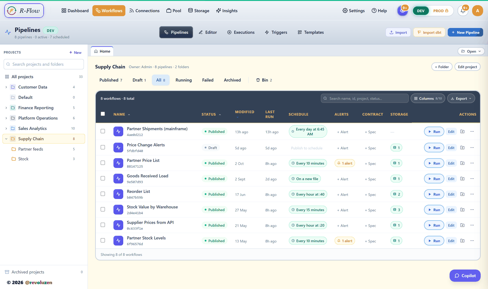

**Connections** — one open framework across databases, warehouses, object
stores, streams and SaaS APIs, each with its own health state.

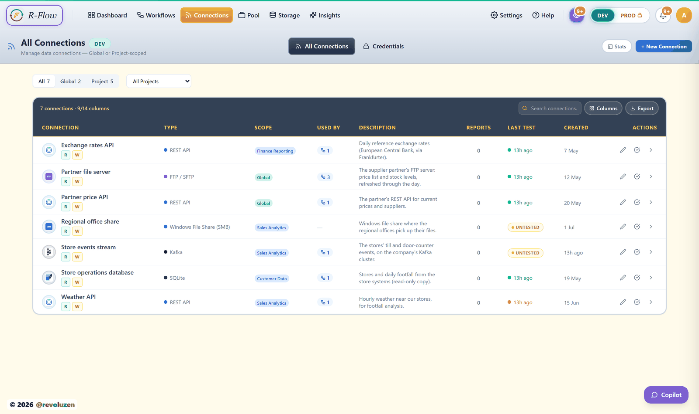

**Executions** — every run, its steps, rows and duration.

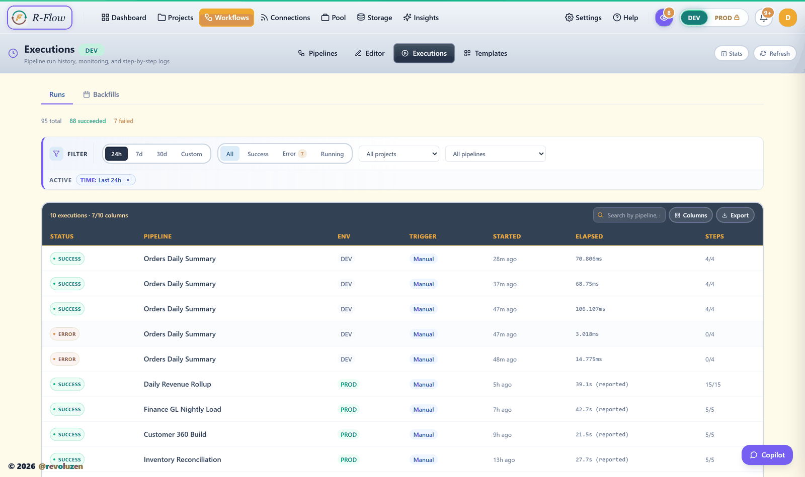

**One run, opened** — runtime lineage of what actually ran, with rows in and
out of each step, per-step timings, peak memory and CPU. Click any node to
read the rows it produced, as a table, a schema or raw JSON, and export them.
Re-run and Replay sit on the same screen.

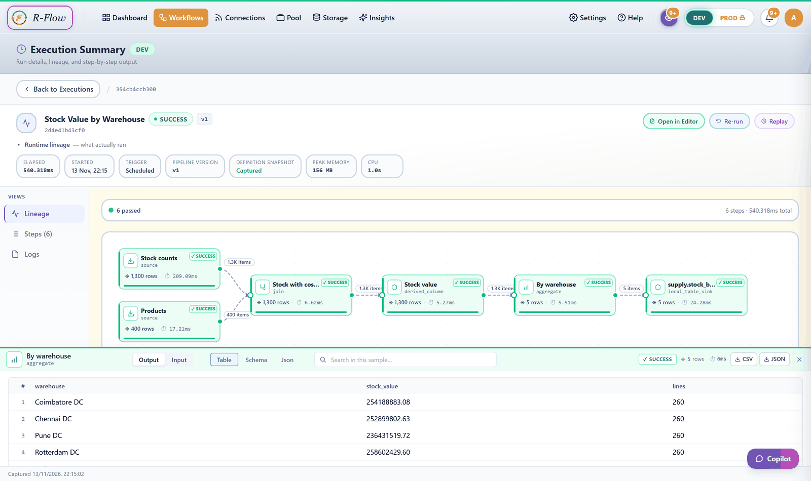

**Every step, with its data** — open a step to see the parameters it ran with,
the rows it received from upstream, and the rows it produced. Samples are
captured at run time, so you are reading what the run actually did rather than
re-querying a source that has since moved on.

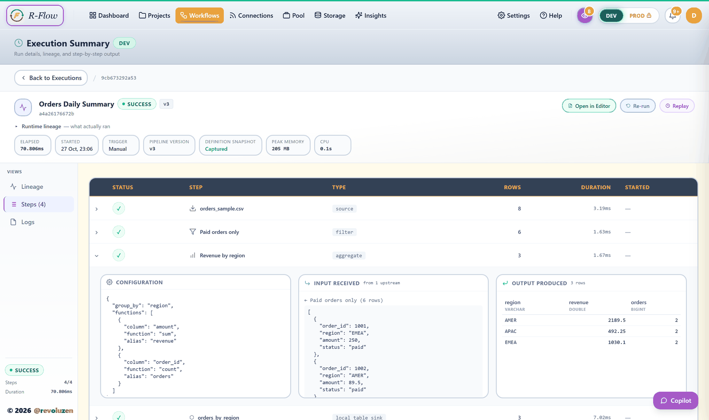

**Triggers** — let another application start a pipeline and pass it values.
Give the pipeline an endpoint, choose how callers prove who they are, and
copy the ready-to-use curl or PowerShell command.

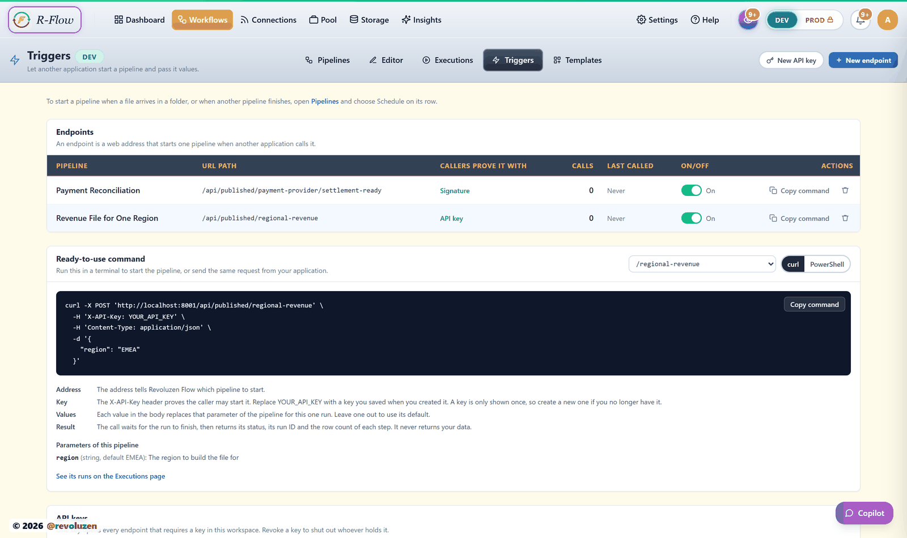

**Storage** — managed parquet tables written by your pipelines.

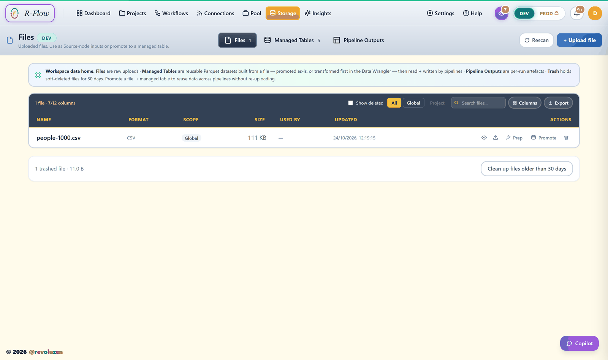

**Any dataset, inspected** — open a table to read its rows and column types,
see which pipeline produced it and which ones consume it.

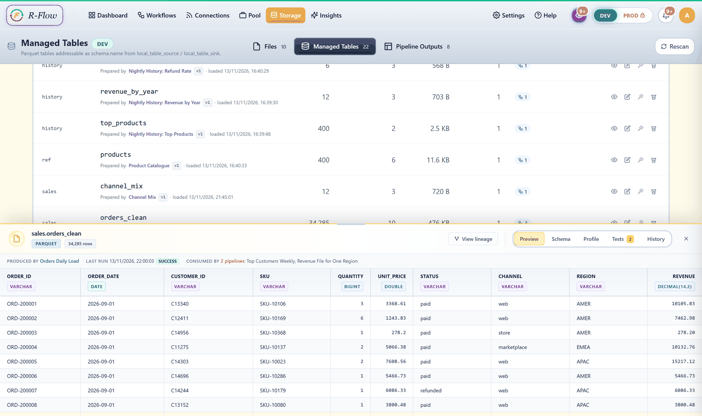

**Steward** — a read-only reliability layer that watches for schema drift,
null and duplicate spikes, connector failures and PII exposure, and tells you
how many scans it has seen each one in.

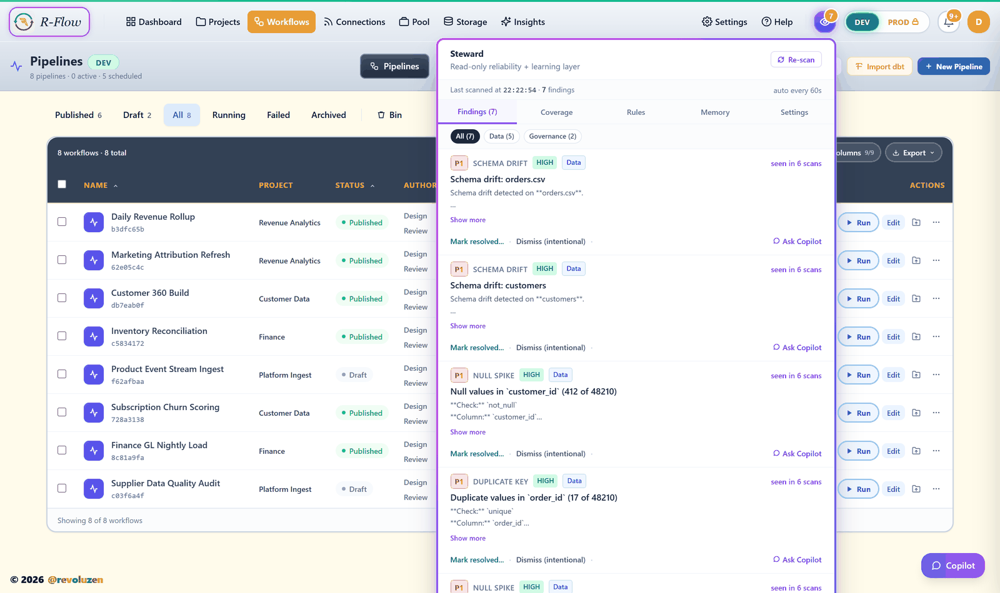

**Bring your own LLM — or keep it on your machine.** Ten providers, two of
them local. Point it at Ollama and pull a model from the list; nothing leaves
the host. AI is optional throughout: turn it off and every feature falls back
to a deterministic path, with the engine unchanged.

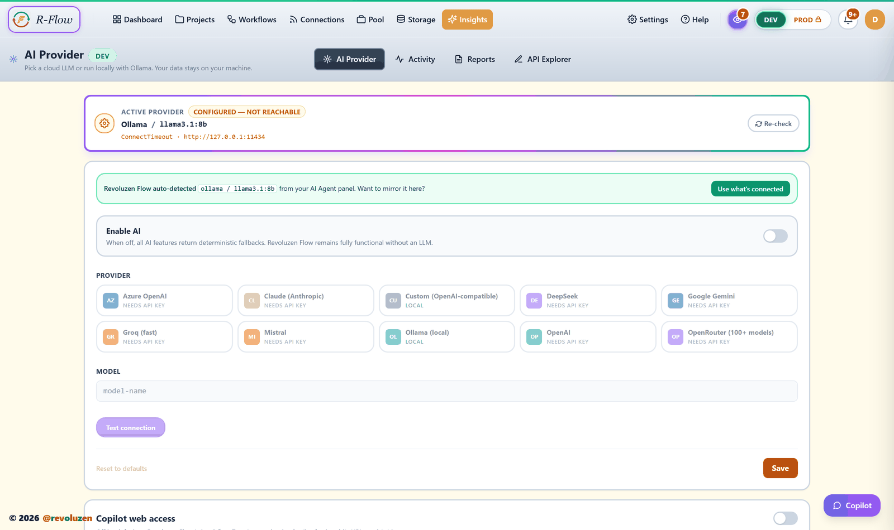

<details>
<summary><strong>More screens — Execution Pool, API Explorer</strong></summary>

**Execution Pool** — concurrency, what is waiting for a slot, and what each
run cost in time, memory and CPU.

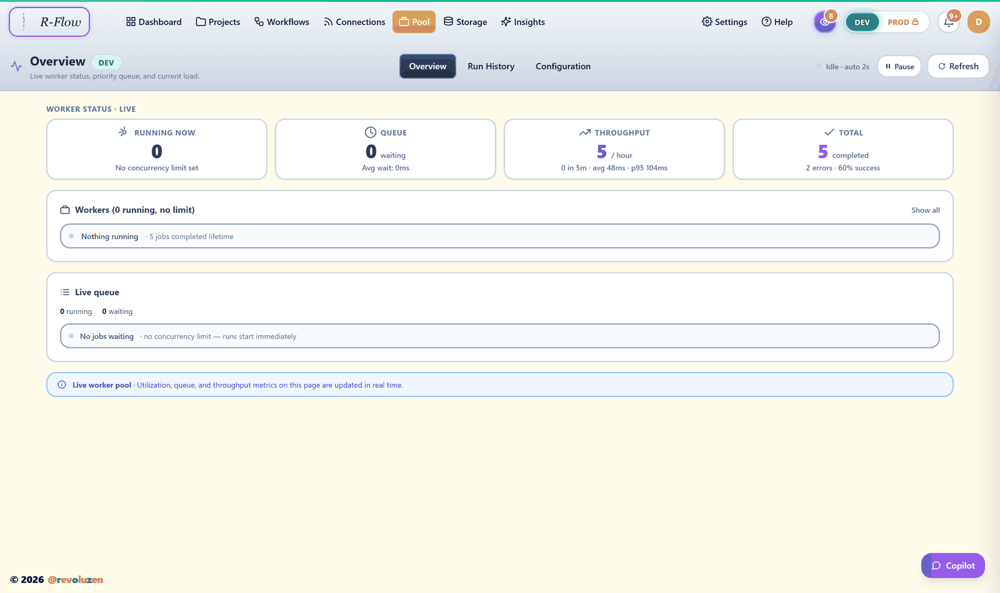

**API Explorer** — load a spec, send one authenticated request, assert on the
response, then generate a connector from it.

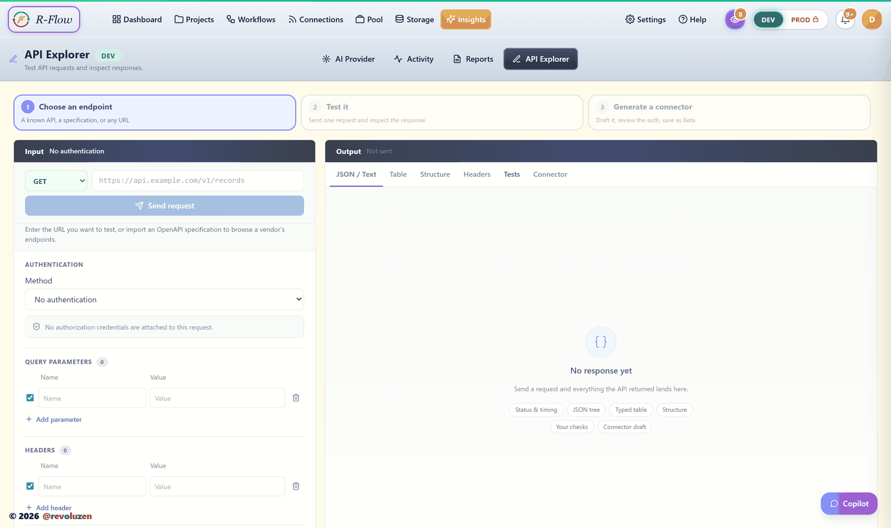

</details>

## First run

On first launch Revoluzen Flow asks you to **create your account** — your email
and a password. This first account owns the instance.

Then open **Templates → First pipeline — CSV in, CSV out → Use Template → Run**.
You'll see real output from a seeded sample dataset in under a minute: no
Postgres, no API keys, no cloud account.

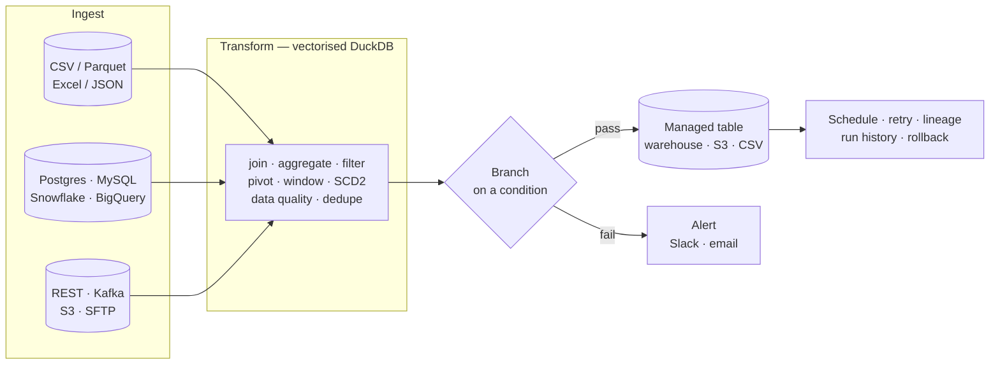

> [!TIP]
> **Automating a headless deploy** that can't do the interactive first run? Set
> `REVOLUZEN_FLOW_BOOTSTRAP_ADMIN=1` and Revoluzen Flow auto-creates
> `admin@revoluzen.local` with a random password — read it with
> `docker compose exec flow cat /data/INITIAL_ADMIN_PASSWORD.txt`, sign in, and
> rotate it.

## Running it

`python -m revoluzen_flow open` starts the backend on a free port (8001 by
default, falling back if in use) and opens your browser. If the output says
`port 8001 was in use — using 8003 instead`, open the printed URL.

```bash
python -m revoluzen_flow serve             # start on 127.0.0.1:8001, open the browser yourself
python -m revoluzen_flow serve --open      # same as `open`
python -m revoluzen_flow serve --port 9000
```

Health check: `curl http://localhost:8001/api/health`

**Headless, WSL2, Docker, DevContainer or remote-SSH?** `open` detects these
automatically, skips the browser launch and prints the URL prominently so you
can paste it into a browser on your host. `--no-open` force-skips the launch
while keeping the port-fallback behaviour.

> [!IMPORTANT]
> **Binding defaults to loopback (127.0.0.1)** — invisible to your LAN, no port
> exposed to coworkers, hotel WiFi or conference networks. If you genuinely need
> LAN-visible binding for an on-prem multi-user install, set
> `REVOLUZEN_FLOW_ALLOW_LAN=1` or pass `--host 0.0.0.0` explicitly. Full
> rationale: [docs/install/security-hardening.md](docs/install/security-hardening.md).

Environment variables: [`.env.example`](.env.example). Day-2 ops (upgrades,
backup, DR, troubleshooting): [docs/deployment.md](docs/deployment.md).

### As a background service

`serve` and `open` run in the **foreground** — fine while trying it out, but
they stop when you close the terminal. For an always-on install that survives
logout and reboot, register with your OS service manager. One command, every
platform:

```bash
python -m revoluzen_flow install-service     # register + start it supervised
python -m revoluzen_flow service-status      # is it running?
python -m revoluzen_flow uninstall-service   # remove it (does NOT delete data)
```

| OS | What it registers | Notes |
|---|---|---|
| **Windows** | Scheduled Task at logon (`schtasks`) | Runs hidden, restarts on crash — no NSSM or pywin32. 1.0.x registers with highest privileges, so run PowerShell as Administrator if you see `REGISTER_FAIL: Access is denied`. |
| **macOS** | launchd LaunchAgent | Auto-starts at login, `KeepAlive` restart. |
| **Linux** | user-mode `systemd` unit | `systemctl --user enable --now`; add `loginctl enable-linger $USER` to keep it running after logout. |

**On Docker instead?** You don't need this — `docker compose up -d` is already
detached, and the compose file's restart policy brings the container back on
reboot or crash.

### Deploy to cloud

Runs on any platform that takes a Docker image. Config files are in the repo root:

| Platform | Config | Quick start |
|---|---|---|
| Fly.io | [`fly.toml`](fly.toml) | `fly launch --copy-config` |
| Render | [`render.yaml`](render.yaml) | New → Blueprint → connect this repo |
| Railway | [`railway.toml`](railway.toml) | New → Deploy from GitHub repo |

> [!WARNING]
> **Persistence matters.** Cloud filesystems are ephemeral by default — every
> restart wipes the SQLite DB and all configuration. Each config above mounts
> `/data` to a managed volume so your work survives restarts. Free tiers have
> small disks; for production sizing see [docs/deployment.md](docs/deployment.md).

## Why Revoluzen Flow

Built for teams who want a local, visual ETL engine without dragging in a
warehouse-first platform or a heavyweight IDE.

| What you get | Why it matters |
|---|---|
| **DuckDB execution** | Joins, group-bys, pivots and aggregates run in a vectorised engine, with disk spill for larger local workloads. |
| **Operations in the box** | Scheduler, endpoints so another application can start a pipeline, alerts, run history, per-step row counts, lineage view, versioning, deploy and rollback are included. |
| **Local-first install** | Runs on a laptop or VM. No cloud lock-in. Telemetry is off by default and opt-in only. |
| **Visual + code workflow** | Drag nodes on the canvas, use expressions for light logic, and drop into DuckDB SQL when the canvas is not enough. |
| **Optional AI assistance** | Claude, OpenAI, Gemini, Ollama and OpenRouter can help with node setup, SQL and error diagnosis; deterministic fallbacks keep the app useful without an LLM. |

> [!NOTE]
> **Evaluating against another orchestrator?** See
> [docs/vs-talend.md](docs/vs-talend.md) for the side-by-side comparison.

## Connectors

Revoluzen Flow ships an open connector framework, not a closed vendor queue.
Current OSS includes native database and bulk-load connectors plus
REST-manifest SaaS connectors, each labeled by maturity: Production, Verified,
Beta, Experimental or Hidden. The picker shows stable tiers first; Experimental
sits behind a toggle. See [docs/connectors.md](docs/connectors.md) or
`GET /api/connectors/cert-matrix` for the live matrix.

Need one that isn't shipped yet?

| Path | Best when |
|---|---|
| Paste an OpenAPI URL | The vendor publishes an OpenAPI spec. |
| Paste sample API responses | The API has no public spec, but you have example payloads. |
| Hand-author a manifest | The API needs custom paging, auth or field mapping. |
| Request or contribute | The connector should become part of the OSS catalog. |

The first three live in **Insights → API Explorer**: load a spec (or any URL),
send one authenticated request, assert on the response, then generate and save
the connector — no restart, no compile step, no LLM.

No connector is Plus-gated. Every OSS manifest, node and extension path stays
open. See [docs/extend/build-a-connector.md](docs/extend/build-a-connector.md)
for the authoring tutorial.

## Steward reliability layer

Steward is a read-only observer for pipeline health. It detects duplicate
sources and pipelines, connector health, schema drift, volume anomalies,
data-quality threshold failures, empty node outputs, warehouse waste,
governance issues and user-defined YAML rules. Findings carry occurrence
counts, severity escalation, rebound detection, sanitized dismiss reasons and
notification de-duplication.

> [!NOTE]
> Steward does not mutate workflows and does not use an LLM to decide
> findings. Its Memory Layer is gated: lessons are proposed first and stay
> inert until a human approves them.

See [docs/steward/overview.md](docs/steward/overview.md),
[docs/steward/positioning.md](docs/steward/positioning.md) and
[docs/steward/architecture.md](docs/steward/architecture.md).

## Editions

Revoluzen Flow is the open-source core for individuals and small teams — a solo,
single-workspace install. Revoluzen Flow Enterprise is a commercial layer adding
team workspaces, RBAC, two-gate approvals, audit logs, vault-backed credentials,
sandbox, drift detection, enterprise deployment and SLA-backed support.

See [edition-matrix.md](edition-matrix.md) for the per-feature breakdown.

## Install troubleshooting

<details>
<summary><strong>Windows: <code>revoluzen</code> is not recognized after install</strong></summary>

If `pip install revoluzen-flow` succeeds but PowerShell says
`The term 'revoluzen' is not recognized`, Revoluzen Flow installed correctly.
Windows just cannot find the generated `revoluzen.exe` because Python's
`Scripts` folder is not on `PATH`. This is a Windows/Python PATH setting, not a
server failure.

Use the Python launcher form:

```powershell
py -m pip install --upgrade revoluzen-flow
py -m revoluzen_flow open
```

If `py` is unavailable, use `python` instead. To confirm where it installed:

```powershell
py -m pip show revoluzen-flow
py -m site --user-base
```

The direct command works only when the matching Python `Scripts` folder is on
your user `PATH` (for example `<user-base>\Scripts`). After changing `PATH`,
close and reopen PowerShell or VS Code.

</details>

<details>
<summary><strong>Intel Macs (x86_64): <code>openssl-sys: Could not find directory of OpenSSL installation</code></strong></summary>

`cryptography` 49+ publishes macOS wheels for Apple Silicon only, so on an Intel
Mac pip falls back to a source build needing a Rust toolchain and OpenSSL
headers. Revoluzen Flow 1.0.1 caps that dependency to the last
Intel-compatible release, so a current install just works.

If you are on 1.0.0 or earlier:

```bash
python3 -m pip install "cryptography<49"
python3 -m pip install --upgrade revoluzen-flow
```

</details>

<details>
<summary><strong><code>error: externally-managed-environment</code></strong></summary>

Homebrew and Debian Pythons refuse system-wide installs. Use a virtualenv:

```bash
python3 -m venv ~/revoluzen-flow-venv
source ~/revoluzen-flow-venv/bin/activate
pip install --upgrade revoluzen-flow
```

</details>

<details>
<summary><strong>Corporate proxy: <code>SSL: CERTIFICATE_VERIFY_FAILED</code></strong></summary>

If `pip install` — or the first `docker compose up` build, which runs `pip`
*inside* the image — fails with
`self-signed certificate in certificate chain`, that's your network's
TLS-inspecting proxy, not Revoluzen Flow. It breaks *any* Python install on that
network. Fixes, best first:

1. **Trust your org's root CA (proper fix).** Get the cert from IT, then
   `pip config set global.cert C:\path\to\corp-ca.pem` and point
   `REQUESTS_CA_BUNDLE` at the same file. For the Docker build, bake the CA into
   the image.
2. **Pull a prebuilt image (cleanest, once published).** A single TLS handshake
   your Docker Desktop proxy settings already handle — no in-network `pip` build.
3. **Quick unblock (less strict).**
   `pip install --trusted-host pypi.org --trusted-host files.pythonhosted.org -e .`

</details>

Full install troubleshooting lives in [docs/quickstart.md](docs/quickstart.md).

## License

Apache License 2.0 — see [LICENSE](LICENSE) and [NOTICE](NOTICE).

"Revoluzen Flow" and "Revoluzen" are trademarks of Revoluzen. See
[TRADEMARK.md](TRADEMARK.md) for usage policy.

## Contributing

**External pull requests are paused for v1.0.0** while our Contributor License
Agreement clears legal review — we won't ask you to sign a draft. Bug reports,
connector and node requests, questions and design feedback are all open and
wanted, and Revoluzen Flow is Apache 2.0 so forking is always yours. See
[CONTRIBUTING.md](CONTRIBUTING.md) for the details and for how to park a fix
you've already written.

[CODE_OF_CONDUCT.md](CODE_OF_CONDUCT.md) has the rules of the road.

## Security

Found a vulnerability? See [SECURITY.md](SECURITY.md). Please do not file public
issues for security reports.

---

<div align="center">

**[Documentation](docs/)** · **[Quick start](docs/quickstart.md)** · **[Enterprise](https://revoluzen.io)** · **[hello@revoluzen.io](mailto:hello@revoluzen.io)**

Built and maintained by **[Revoluzen](https://revoluzen.io)** · Apache 2.0

</div>
